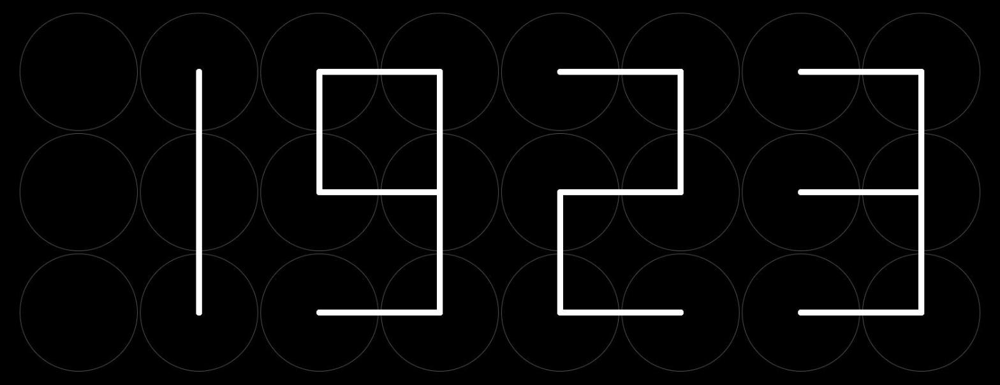
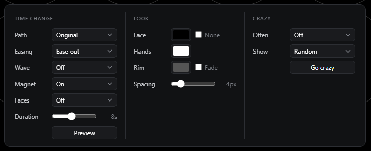
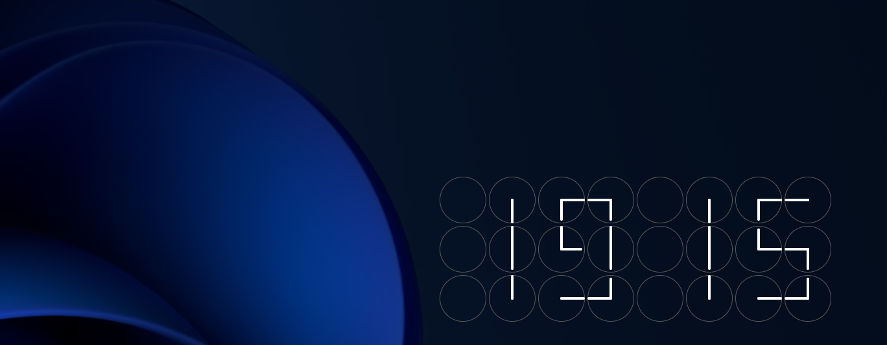
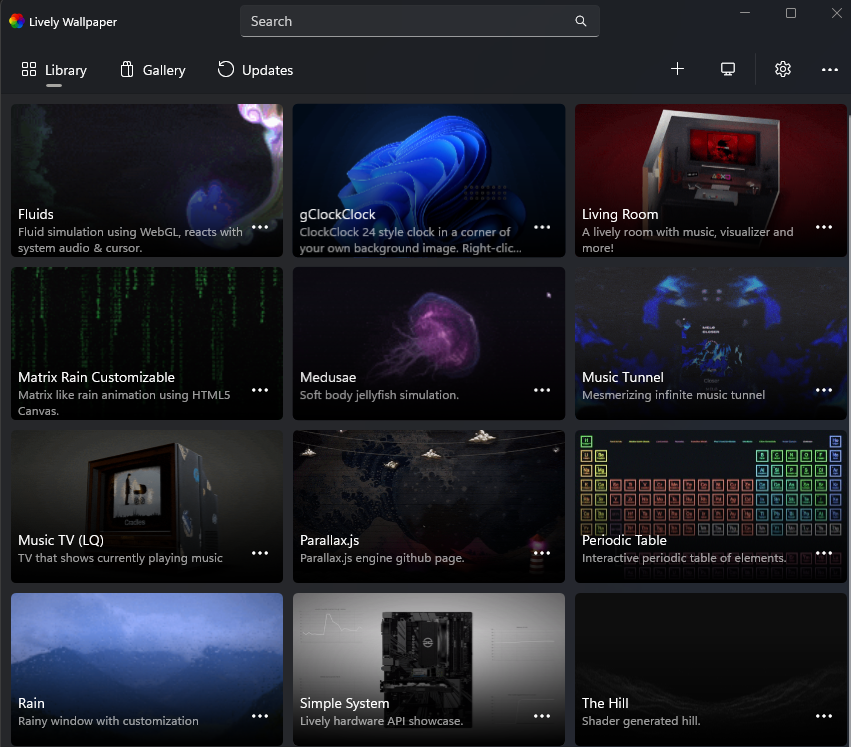
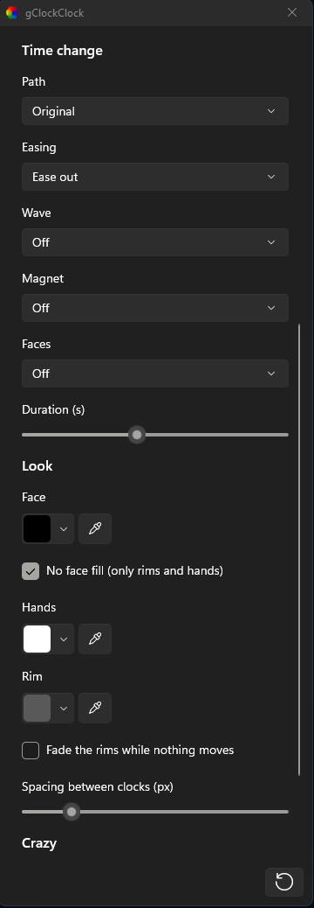

# gClockClock

A ClockClock 24 style clock in the browser: 24 small analog clocks whose hands turn together to
form the time. One HTML file, no build, no dependencies.



**Live:** https://geeforceone.github.io/gClockClock/clock.html

## Use

Open `clock.html` in a browser (or the live link). The clock fills the whole window.

- **Click the first clock** (top left) to open the options. A click outside the panel (or Esc)
  closes it. Settings are kept in the browser.
- **Click the last clock** (bottom right) to play a crazy show, such as Billiard.



| Column | Settings |
| --- | --- |
| Time change | How the hands move to the next time: Path, Easing, Wave, Magnet (joined strokes), Faces (face moves), Duration. Preview plays a change. |
| Look | Face color (or None), hand color, rim color, Fade (rims fade out while nothing moves), spacing between the clocks |
| Crazy | How often a crazy show plays, which show (Random picks one). Go crazy plays it now. |

All settings can also be given in the URL, e.g. `clock.html?path=spin&hand=ffcc00&fade`.

## Windows desktop wallpaper (Lively)

The clock can sit in a corner of your desktop background, using the free app
[Lively Wallpaper](https://github.com/rocksdanister/lively).



### Install

1. Install **Lively Wallpaper** from the Microsoft Store or from its
   [GitHub releases](https://github.com/rocksdanister/lively/releases), and start it once.
2. Open **PowerShell** (Start menu → type "PowerShell") and run:

   ```
   irm https://raw.githubusercontent.com/geeForceOne/gClockClock/main/lively-setup.ps1 | iex
   ```

   It creates **`gClockClock-lively.zip`** in your Downloads folder and shows it in Explorer.
3. Drag the zip onto the Lively window. **gClockClock** appears in the library.
4. Click the tile to set it as your wallpaper.



### Customize

In the Lively library, click **⋯** on the gClockClock tile (or right-click it) and choose
**Customize**. Changes show on the desktop right away; **Restore default** (bottom right) resets
everything.



- **Background:** pick an image from the list, or click the folder button to add your own
  picture (Lively copies it into the wallpaper). Or paste the link of an image on the web into
  **Image URL**; it is used instead of the picked image. **Color** shows where there is no image,
  and while a web image can't load.
- **Clock position:** the corner (or the center), the clock's width in % of the screen, and the
  distances from the side and from the top or bottom in pixels.
- **Time change, Look, Crazy:** the same options as in the browser panel. In the wallpaper the
  first clock doesn't open the options; they are all here, because Lively forgets what a page
  saves when it closes.

Your Windows wallpaper can't shine through: Lively draws the whole screen, so the picture behind
the clock is the one set here. With your current background, choose the folder button and pick it
from `C:\Windows\Web\Wallpaper` (the built-in ones) or wherever it is saved.

<br clear="right">

### Update

Run the same PowerShell line again:

```
irm https://raw.githubusercontent.com/geeForceOne/gClockClock/main/lively-setup.ps1 | iex
```

It finds the installed wallpaper, closes Lively, puts the latest version in place and starts Lively
again. Your Customize settings and the pictures you added stay; new settings start with their
defaults. Run it whenever you want the latest version; the wallpaper doesn't update by itself.

The script can also be downloaded and run as a file:
`powershell -ExecutionPolicy Bypass -File lively-setup.ps1` (options: `-Yes` skips the question
before closing Lively, `-Branch <name>`, `-Source <folder>` for a local copy of this repo).

### Remove

In the Lively library, click **⋯** on the gClockClock tile and choose **Delete**.

## Raspberry Pi kiosk

`kiosk-setup.sh` turns a fresh Raspberry Pi OS (labwc) into a full-screen clock in Chromium kiosk
mode. Run it as the normal user:

```
curl -sLO https://raw.githubusercontent.com/geeForceOne/gClockClock/main/kiosk-setup.sh
bash kiosk-setup.sh                 # options: --url URL, --upside-down, --no-sudo
sudo reboot
```

The page checks for a new version every 5 minutes and reloads itself, so the kiosk updates on its
own.

## License

[MIT](LICENSE)
